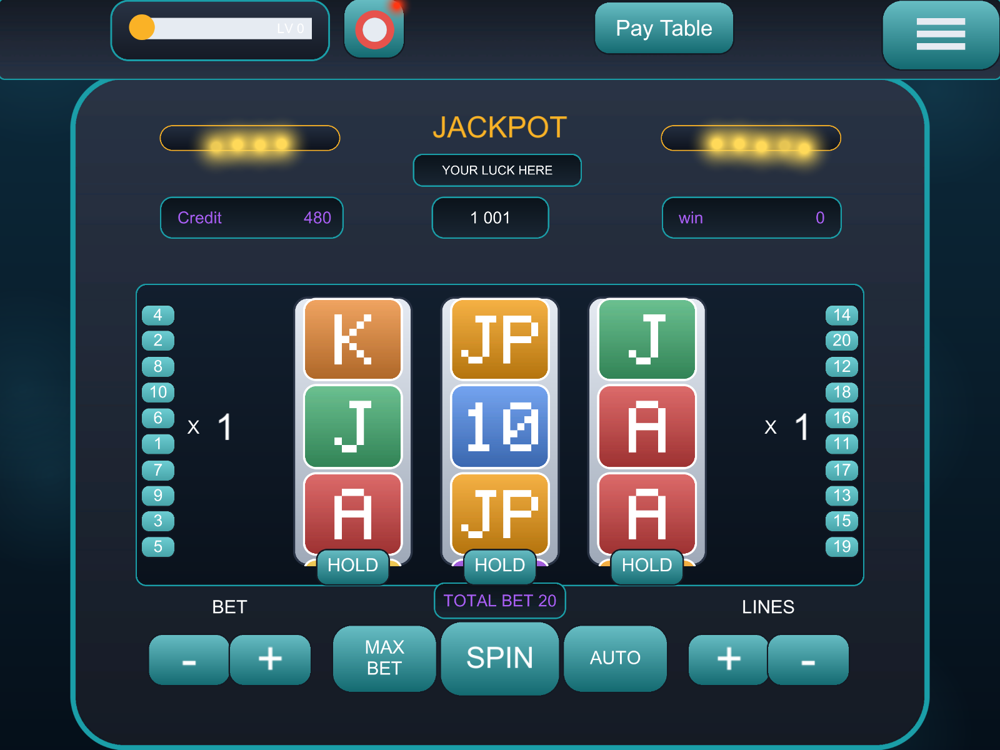

# Classic Slots 3x3 (Unity showcase)

A classic **3-reel, 3-row, 20-payline** slot machine in Unity 6, written in plain C#.
This repository is a portfolio sample. Every sprite, sound and label is **generated by code**, and there are no
store or licensed assets. The code is kept small and readable, so a junior developer can follow a spin from button
to payout.



## Features
- Three reels that turn like real cylinders, with motion blur, a wind-up and an overshoot
- 20 selectable paylines, line bet 1-20, max bet and auto spin
- Wild substitution, scatter, free spins and a progressive jackpot
- Hold feature: hold up to two reels for a higher stake
- 7-day daily reward streak, level progress and a saved balance
- Big-win popup, pay table and settings windows, plus music and sound toggles

## Run it
1. Open the folder with Unity **6000.3.10f1** (Unity 6).
2. Open `Assets/Scenes/Classic3x3.unity` and press **Play**.
3. To rebuild the scene from code, use the menu **Slot3x3 > Build Classic Scene**.

## How the code is organised

```
Assets/Scripts
├── Core/Services  GameServices + ISaveStore, IRandomSource (and their implementations)
├── Data           SlotConfig (ScriptableObject): symbols, reel strips, pay table, bets
├── Reels          Reel (the rotating cylinder), SlotTile (one symbol)
├── Lines          20 paylines: selection, drawing, winning-line data
├── Slot           SlotMachine (spin flow), SlotControls (bet panel), WinEvaluator, Payout, WinPresenter
├── Player         PlayerWallet (coins, level), daily reward schedule + controller
├── Audio          ISoundPlayer + SoundController
├── UI             Popups, lamps, coin fountain, level bar
├── Input          World-space buttons
└── Editor         Scene builder + code-drawn art (PlaceholderArt, SymbolArt) and sound (SynthSounds)
```

A spin, step by step:

```
SpinButton -> SlotMachine.StartSpin -> take the bet -> Reel.Spin (x3)
           -> WinEvaluator.Search -> Payout.Coins / FreeSpins -> PlayerWallet -> WinPresenter
```

### SOLID in practice
- **Single responsibility**: finding wins (`WinEvaluator`), working out the payout (`Payout`) and showing it
  (`WinPresenter`) are three separate classes.
- **Open/closed**: symbols, reel strips and pay rules are data in `SlotConfig`, so you add content without changing code.
- **Dependency inversion**: gameplay depends on the interfaces `ISaveStore`, `IRandomSource` and `ISoundPlayer`
  (handed out by `GameServices`), not on PlayerPrefs, `UnityEngine.Random` or a concrete audio component.

Read [docs/ARCHITECTURE.md](docs/ARCHITECTURE.md) for the full walkthrough: the reel cylinder maths, reel strips,
the pay table with wilds, and the payout formula.

## Tests
- **EditMode** (`Assets/Tests/EditMode`): pay table and wild variants, daily reward rules, number formatting,
  the save store, seeded randomness and the payout rules.
- **PlayMode** (`Assets/Tests/PlayMode`): loads the real scene and plays a spin. Set `SHOWCASE_SHOT=<file.png>`
  to also save a screenshot (that is how the image above is made).

Run them from **Window > General > Test Runner**, or from the command line:

```bash
Unity -batchmode -nographics -projectPath . -runTests -testPlatform EditMode -testResults results.xml
```

## Placeholder assets
| Asset | Made by |
| --- | --- |
| Machine, buttons, coins, lamps | `Editor/PlaceholderArt.cs` |
| Reel symbols (and blur) | `Editor/SymbolArt.cs` with a 5x7 pixel font |
| Music and sound effects | `Editor/SynthSounds.cs` (written as WAV files) |
| Font | Unity's built-in font |

To re-skin the game, replace the PNGs in `Assets/Art/Generated` with real art of the same name and size, then rebuild
the scene.
